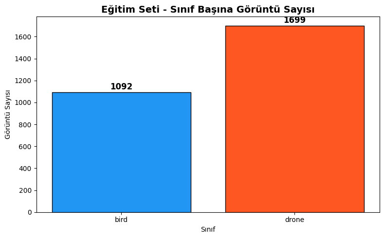
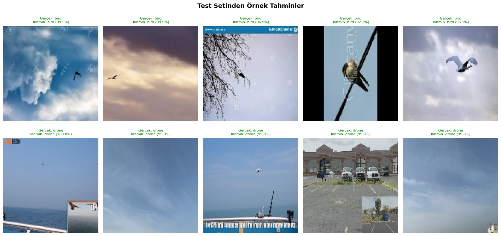

# Drone vs Bird Sınıflandırma — Custom CNN

[](https://colab.research.google.com/github/yunusemrearslan37/drone-vs-bird-custom-cnn/blob/main/BIM430_DroneVsBird_CustomCNN.ipynb)

Hava görüntülerinde **drone** ile **kuş** ayrımı yapan ikili sınıflandırma projesi. Model **sıfırdan** tasarlanmış bir **Custom CNN** kullanır (transfer learning backbone yok).

## Öne çıkanlar

| Madde | Detay |
|------|--------|
| Model | Custom CNN (4 conv block: 32→64→128→256) |
| Input size | 128×128×3 |
| Sınıflar | Bird, Drone |
| Mimari | Conv2D → BatchNorm → ReLU (×2) → MaxPool → Dropout; GAP + Dense; sigmoid çıktı |
| Parametre | ~1.28M toplam (1.276.449) |

## Veri seti

- **Kaynak:** [Drone vs Bird (Kaggle)](https://www.kaggle.com/datasets/muhammadsaoodsarwar/drone-vs-bird)
- **Toplam:** 4.106 görsel — bird: 1.607, drone: 2.499
- **Split:** Train 2.789 · Validation 493 · Test 822
- **Data augmentation:** rotation (±20°), width/height shift, shear, zoom, horizontal flip



## Sonuçlar (test set)

| Metrik | Skor |
|--------|------:|
| Accuracy | **95.26%** |
| Precision | 95.25% |
| Recall | 95.26% |
| F1-Score | **95.25%** |

Eğitim 42 epoch sürdü; early stopping / best-weights checkpoint kullanıldı.

### Örnek tahminler (test seti)



## Kullanılan teknolojiler

- Python, TensorFlow / Keras
- scikit-learn (classification report, confusion matrix)
- Matplotlib / Seaborn
- kagglehub
- Google Colab (GPU önerilir)

## Nasıl çalıştırılır?

1. [`BIM430_DroneVsBird_CustomCNN.ipynb`](BIM430_DroneVsBird_CustomCNN.ipynb) dosyasını [Google Colab](https://colab.research.google.com) veya Jupyter'da aç (yukarıdaki Colab rozetine tıklaman yeterli).
2. Runtime → Change runtime type → **GPU**.
3. Hücreleri sırayla çalıştır.

```bash
pip install -r requirements.txt
```

Notebook, Kaggle veri setini çalışma sırasında indirir. Ağırlık dosyaları ve ham görüntüler `.gitignore` ile dışarıda bırakılmıştır.

## Proje yapısı

```text
drone-vs-bird-custom-cnn/
├── README.md
├── requirements.txt
├── .gitignore
├── BIM430_DroneVsBird_CustomCNN.ipynb
└── images/
    ├── class_distribution.png
    └── sample_predictions.png
```

## Lisans

Eğitim / portfolio amaçlı proje. Veri seti lisansı Kaggle kaynak sayfasındaki koşullara tabidir.
